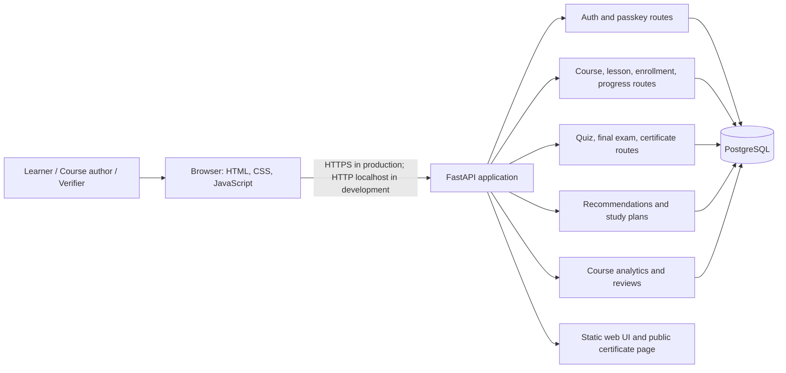

# Week 6: Current architecture and design critique

## Architecture diagram

## Current design

The application is a modular monolith: one FastAPI process exposes feature-focused routers and serves the browser application. The routers share SQLAlchemy models and one PostgreSQL database. Alembic migrations manage schema changes. The browser uses the JSON API and WebAuthn browser APIs for device verification.

## Critique

### What fits the current project

- One deployable application keeps setup and operation manageable for a small course project.
- Routers make major feature areas visible without introducing network boundaries prematurely.
- PostgreSQL fits the relational links among learners, courses, lessons, enrollments, assessments, and certificates.
- Serving the static frontend from the API keeps the local MVP simple.

### Risks and improvement areas

- The database URL is read from `DATABASE_URL`, with a local development fallback. Production still needs the correct hosted URL and secret configuration.
- Several feature routers directly share ORM models and a database session. As the app grows, service-layer boundaries and explicit transaction ownership would make behavior easier to test.
- Serving the frontend from the backend couples frontend and API deployments. This is acceptable now, but the choice should be revisited if independent release cadence becomes important.
- Passkey relying-party ID and origin must be configured for the real HTTPS domain. Localhost defaults are not production settings.
- CI now runs the backend regression suite, Python and browser JavaScript syntax checks, and Docker Compose configuration validation. The suite is useful regression coverage, not a full end-to-end or load test.
- Operational needs such as backups, logging, monitoring, rate limits, and uploaded-media storage need a deployment-specific plan.

## Week 7 deployment evidence

Render is the selected host and `render.yaml` describes a free-tier deployment. A temporary free PostgreSQL database was provisioned, but no web service or public URL exists yet because Render currently cannot access the GitHub repository. After repository access is fixed, deploy the Blueprint, verify the migration and `/health` endpoint, and record the public URL and results here. Do not put credentials in this document.
